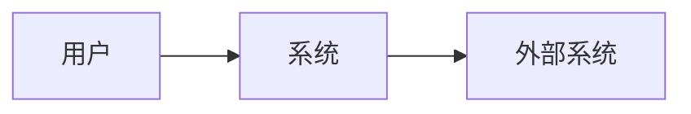
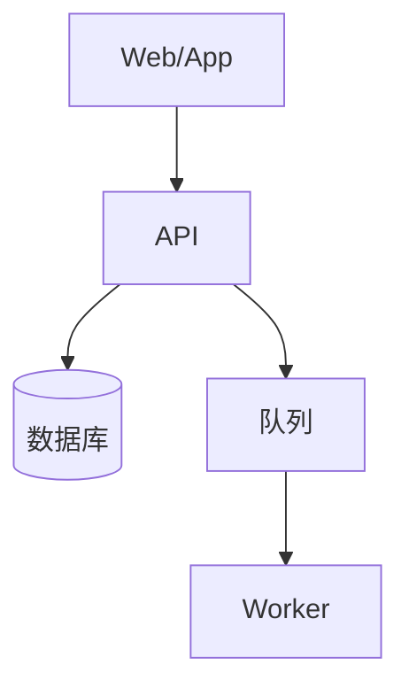
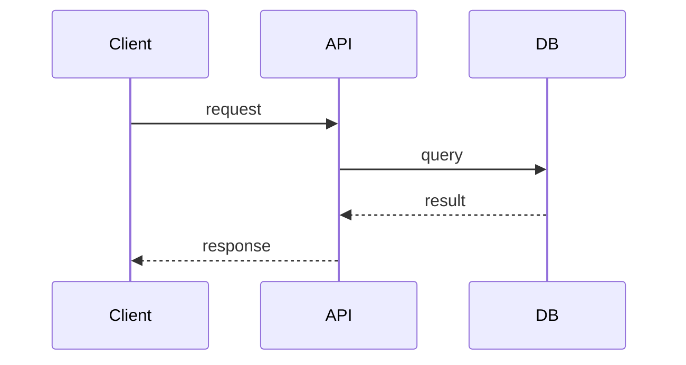

# Architecture — <系统名>

- 版本：
- Owner：ai-team/system-architect
- 关联需求：FR-... / NFR-...

## 1. 目标与约束

- 目标：
- 约束：
- 关键用例：

## 2. 上下文（C4 Context）

## 3. 容器/组件

| 模块 | 职责 | 依赖 | 数据所有权 |
|---|---|---|---|
| ... | ... | ... | ... |

## 4. 关键流程

### 4.1 成功路径

### 4.2 失败/重试/降级

- 超时：
- 重试：
- 幂等：
- 降级：
- 补偿：

## 5. 数据模型

| 实体 | 字段 | 关系 | 索引 | 保留 |
|---|---|---|---|---|
| ... | ... | ... | ... | ... |

## 6. API/事件契约

- 规范：OpenAPI 3.1 / AsyncAPI / Protobuf
- 认证：
- 错误模型：
- 版本/兼容：
- 幂等/分页/限流：

## 7. 安全设计

- 认证/授权：
- 租户隔离：
- 密钥：
- 审计：
- 隐私：

## 8. 非功能设计

| NFR | 设计 | 验证 |
|---|---|---|
| 性能 | ... | ... |
| 可用性 | ... | ... |
| 容量 | ... | ... |
| 恢复 | RPO/RTO | ... |

## 9. 部署与可观测性

- 拓扑：
- 环境：
- 发布/回滚：
- 日志/指标/trace/告警：

## 10. ADR 索引

| ADR | 决策 | 状态 |
|---|---|---|
| ADR-0001 | ... | accepted |

## 11. 未决问题

| ID | 问题 | Owner | 截止 |
|---|---|---|---|
| ... | ... | ... | ... |
