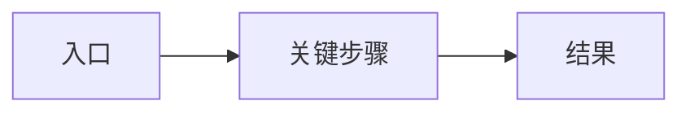

# PRD — <产品/功能名>

- 版本：
- 日期：
- Owner：ai-team/product-manager
- Track：

## 1. 背景与问题

<谁、在什么场景、遇到什么问题、现有替代方案、为什么现在做>

## 2. 目标与非目标

**目标：**

- ...

**非目标：**

- ...

## 3. 用户与角色

| 角色 | 目标 | 痛点 | 权限 |
|---|---|---|---|
| ... | ... | ... | ... |

## 4. 用户旅程

## 5. 功能需求

| ID | 需求 | 优先级 | 验收标准 | 备注 |
|---|---|---|---|---|
| FR-001 | ... | Must | ... | ... |

## 6. 非功能需求

| ID | 类别 | 目标 | 测量方式 |
|---|---|---|---|
| NFR-001 | 性能 | p95 < ... | ... |
| NFR-002 | 可用性 | ... | ... |
| NFR-003 | 安全/隐私 | ... | ... |
| NFR-004 | 可访问性 | WCAG 2.2 AA | ... |

## 7. 数据与合规

- 收集的数据：
- 敏感级别：
- 保留/删除：
- 合规要求：

## 8. 验收与成功指标

| 指标 | 目标 | 测量 |
|---|---|---|
| ... | ... | ... |

## 9. 假设、依赖、开放问题

| ID | 内容 | Owner | 截止 | 状态 |
|---|---|---|---|---|
| Q-001 | ... | ... | ... | open |

## 10. Roadmap

| 阶段 | 范围 | 目标日期 | 依赖 | 退出标准 |
|---|---|---|---|---|
| MVP | ... | ... | ... | ... |
| Next | ... | ... | ... | ... |
| Later | ... | ... | ... | ... |

## 11. 发布/灰度/回滚要求

- ...
