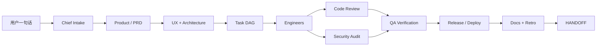

# AI Native Engineering Team

> 一个可全局安装、适用于任何软件项目的 AI 工程团队。  
> 一句 `/ai 帮我做一个……`，从产品规划、UI 设计、架构、编码、审查、测试、安全到一键部署，自动跑完整个研发闭环。

这不是一组“会写代码的 prompt”，而是一支有**角色边界、阶段门禁、共享记忆、证据标准、安全审查和发布回滚**的虚拟工程团队。

---

## 1. 一句话启动

在任意 OpenCode V2 项目中：

```text
/ai 做一个支持多人协作的周报工具，Web 端，先做 MVP，能部署到 Docker
```

Chief 会自动：

1. 读取/初始化 `.ai-team/` 项目记忆；
2. 判定 Track（T0 Spike / T1 Patch / T2 Feature / T3 Product / T4 Critical）；
3. 调度产品经理 → UX → 架构 → 工程 → 代码审查 → QA → 安全 → DevOps → 文档；
4. 按门禁推进，直到 Definition of Done 或真正阻塞；
5. 留下可审计的状态、任务、决策、风险、测试、审查、发布与 HANDOFF 证据。

你不需要逐轮指挥；只有在**不可逆决策**（生产部署、删数据、支付/密钥/合规）时，Chief 才会用一个合并问题请你拍板。

---

## 2. 团队名册

| 角色 | Agent ID | 负责 | 不负责 |
|---|---|---|---|
| **总负责人 / 交付 Lead** | `ai-team/chief` | 分类、编排、门禁、证据、风险、对用户负责 | 不写需求/设计/代码/测试/部署 |
| **产品经理** | `ai-team/product-manager` | 产品发现、PRD、用户故事、优先级、验收、UAT | 不做 UI/架构/实现 |
| **UI/UX 设计师** | `ai-team/ux-designer` | 用户流程、线框/UI 规格、设计系统、可访问性 | 不写生产代码 |
| **系统架构师** | `ai-team/system-architect` | 架构、技术选型、数据/API 契约、NFR、ADR | 不写实现/测试/部署 |
| **软件工程师** | `ai-team/engineer` | 任意技术栈实现、单元测试、迁移、自测 | 不改需求/设计/审查结论/部署 |
| **代码审查员** | `ai-team/code-reviewer` | 正确性、契约、测试质量、可维护性、越权 | 不改代码，只出报告 |
| **测试工程师** | `ai-team/qa-engineer` | 测试策略、自动化、E2E、性能、缺陷、回归 | 不修生产代码 |
| **安全审计员** | `ai-team/security-auditor` | 威胁建模、设计/代码/依赖/密钥/IaC/发布安全 | 不修代码，只出报告 |
| **DevOps/交付** | `ai-team/devops-engineer` | 仓库基线、CI/CD、容器、IaC、一键部署、可观测性、回滚 | 不写业务代码 |
| **技术文档** | `ai-team/technical-writer` | README、API、运维手册、CHANGELOG、发布说明 | 不写生产代码 |

每个角色都有独立的文件所有权和权限边界；审查者不能改代码，工程师不能改需求/设计，Chief 不能替成员干活。

---

## 3. 工作流



### Track（按任务大小裁剪流程）

| Track | 场景 | 流程 |
|---|---|---|
| **T0 Spike** | 调研/可行性/原型 | Intake → 调查 → 评审 → 报告 |
| **T1 Patch** | Bug/小改动 | Intake → 修复 → 代码审查 → 回归测试 |
| **T2 Feature** | 现有产品加功能 | PRD-lite → 设计 note → 实现 → 审查 → 测试 → 安全检查 |
| **T3 Product** | 从零做产品/MVP | G0–G8 全流程 |
| **T4 Critical** | 生产关键/合规/支付/多租户 | G0–G8 + 威胁建模/合规/性能/容灾/UAT/灰度 |

小任务不会被强行套全套 PRD；但**审查、测试、证据**不会被裁剪。

### 门禁

| 门禁 | 内容 |
|---|---|
| G0 Intake | 目标、Track、范围、成功指标、约束、假设、风险 |
| G1 Product | PRD、FR/NFR、验收、优先级、开放问题 |
| G2 Design | UX、架构、ADR、数据/API 契约、威胁模型、测试策略 |
| G3 Plan | 任务 DAG、owner、依赖、验收、证据、文件所有权 |
| G4 Build | 代码 + 单元测试 + lint/typecheck/build + 证据 |
| G5 Verify | 代码审查 + QA 覆盖矩阵 + 缺陷关闭 |
| G6 Secure | 威胁模型 + 代码/依赖/密钥/IaC/容器/发布安全 |
| G7 Release | CI + 部署 + 冒烟 + 回滚 + 监控 + 生产批准 |
| G8 Operate | 发布后健康、复盘、GROWTH、HANDOFF |

---

## 4. 命令

| 命令 | 作用 |
|---|---|
| `/ai <目标>` | **一句话启动完整流程**（主入口） |
| `/ai-plan <目标>` | 只做产品、UX、架构与任务计划，不写代码 |
| `/ai-design <目标>` | 只做 UX/架构/契约设计 |
| `/ai-review [范围]` | 代码审查 + 安全审计，只出报告 |
| `/ai-test [范围]` | 测试策略、执行、缺陷、报告 |
| `/ai-deploy [环境]` | 发布预检、部署、冒烟、回滚（生产需批准） |
| `/ai-status` | 查看阶段、任务、风险、下一步 |
| `/ai-resume` | 从 `HANDOFF.md` 恢复并继续 |
| `/ai-handoff` | 写入 HANDOFF，生成新会话首条指令（不自动开会话） |
| `/ai-hotfix <问题>` | T1 快速修复 + 回归 + 复盘 |
| `/ai-retro [范围]` | 复盘与团队改进提案（每 10 个 done / 门禁前 / 事故后） |
| `/ai-docs [范围]` | README/API/运维/CHANGELOG，并验证命令 |

所有命令默认进入 `ai-team/chief`。也可以直接选择 agent：`ai-team/chief`。

---

## 5. 项目记忆：`.ai-team/`

团队不依赖聊天历史。每个项目在第一次运行时创建 `.ai-team/`：

```text
.ai-team/
  .gitignore        # 跟踪 .ai-team 时复制 templates/AI-TEAM-GITIGNORE
  state/
    PROJECT.md      # 目标、Track、范围、成功指标、假设
    STATUS.md       # 当前阶段、门禁、进行中、阻塞、下一步
    TASKS.md        # 任务板（ID、owner、依赖、验收、证据）
    DECISIONS.md    # 决策日志
    RISKS.md        # 风险登记
    HANDOFF.md      # 跨会话交接
    RUN_LOG.md      # 时间线
    CHECKPOINT.json # 最近 checkpoint 的 commit/任务数基线
  product/          # PRD、用户故事、验收、追踪矩阵
  design/ux/        # 流程、UI 规格、设计系统、可访问性
  design/architecture/  # 架构、数据、API、失败模式、部署、可观测性
  design/adr/       # 架构决策记录
  tasks/            # 任务详情
  work/             # 任务证据（命令、退出码、输出）
  reviews/          # 代码审查报告
  security/         # 威胁模型、安全审查
  qa/               # 测试策略/计划/用例/报告/缺陷
  release/          # 发布计划、部署、回滚、runbook
  docs/             # 文档计划与评审
  team/             # 复盘与成长提案
```

ID 规范：`TASK-0001`、`DEC-0001`、`RISK-0001`、`REV-0001`、`SEC-0001`、`DEF-0001`、`REL-0001`、`ADR-0001`。

---

## 6. 安装

### 全局安装（推荐，任何项目可用）

前置：已获取本仓库（`git clone` 或下载解压），并进入仓库根目录。

Windows PowerShell：

```powershell
cd <path-to-this-repo>
powershell -NoProfile -ExecutionPolicy Bypass -File .\scripts\install.ps1 -DryRun
powershell -NoProfile -ExecutionPolicy Bypass -File .\scripts\install.ps1
```

Linux/macOS：

```bash
cd /path/to/ai-native-team
./scripts/install.sh --dry-run
./scripts/install.sh
```

安装到：

```text
~/.config/opencode/
  agents/ai-team/*.md
  commands/ai*.md
  skills/ai-team-*/**
  ai-team-install.json   # 版本/安装指纹
```

不会覆盖你的其他 agent/command/skill；同名文件会先备份。

**安装后下一步**：先跑下面的验证，然后在任意项目输入 `/ai <目标>`。

### 项目内安装（只对当前项目生效）

把本仓库的 `.opencode/` 复制到项目根目录，或在项目中保留一份：

```text
<project>/.opencode/agents/ai-team/...
<project>/.opencode/commands/ai*.md
<project>/.opencode/skills/ai-team-*/**
```

项目配置优先级高于全局；适合固定团队规范或离线分发。

### 设为默认 agent（可选）

在 `~/.config/opencode/opencode.json(c)` 加：

```jsonc
{
  "default_agent": "ai-team/chief"
}
```

或使用：

```bash
node scripts/merge-default.mjs --config ~/.config/opencode/opencode.jsonc
```

不改默认也可以：每次用 `/ai ...` 即可。

### 验证

```bash
# 1) 包结构验证（在仓库根目录）
node scripts/verify.mjs
# 期望：checks: 192, passed: 192, failed: 0
#       OK: package is structurally valid.
# 退出码 0 = 通过；1 = 有 FAIL，按输出中的 FAIL 行修复。

# 2) 全局安装验证
node scripts/verify.mjs --root ~/.config/opencode --installed --opencode
# 期望：checks: 194, passed: 194, failed: 0
#       opencode lists ai-team/chief ... 全部 PASS
# `~` 由脚本展开；PowerShell 也可写 $env:USERPROFILE\.config\opencode
# `--opencode` 会调用 `opencode agent list`（稍慢），确认 OpenCode 真正识别 agent。

# 3) 直接看 OpenCode 识别结果
opencode agent list | Select-String "ai-team/"
# 期望看到 ai-team/chief (primary) 以及 9 个 subagent

# 4) 版本
node scripts/version.mjs --check
# 期望：status up-to-date，exit 0
```

更完整的四层验证（结构/安装/OpenCode 识别/smoke test）见 [INSTALL.md](INSTALL.md#5-验证)。

### 版本管理

安装成功后会在配置目录写入版本标记：

```text
~/.config/opencode/ai-team-install.json
```

包含：版本、安装时间、源路径、包指纹（sourceHash/installedHash）、agent/command/skill 数量。包指纹能发现“版本号没变但内容被改过”的情况。

```bash
# 查看源版本 vs 已安装版本
node scripts/version.mjs

# CI/脚本检查：0=一致，1=需更新/漂移，2=未安装，3=unknown
node scripts/version.mjs --check

# 更新已安装版本：源验证 → 安装 → 安装后验证 → 写版本标记
node scripts/version.mjs --update

# 强制重装 / 降级
node scripts/version.mjs --update --force

# 机器可读
node scripts/version.mjs --json
```

状态含义：

| 状态 | 含义 | 处理 |
|---|---|---|
| `up-to-date` | 版本与包指纹都一致 | 无需操作 |
| `update-available` | 已安装版本低于源版本 | `--update` |
| `drift` | 版本相同，但源包或已安装副本内容变了 | `--update`；维护者记得 bump version |
| `incomplete` | 上次安装不完整（sourceHash ≠ installedHash） | `--update` |
| `legacy` | 有团队文件但没有版本标记（旧安装） | `--update` |
| `not-installed` | 目标目录没有团队文件 | `--update` 或 `install` |
| `installed-newer` | 已安装版本高于源版本 | 更新源，或 `--force` 降级 |
| `unknown` | 标记损坏/缺字段 | `--update --force` |

### 维护者：标准迭代流程

团队级优化的**唯一源真相**是本仓库；`~/.config/opencode` 是安装产物。  
不要直接改安装副本——下次发布会覆盖它。

#### 1. 先判断改动范围

| 改动类型 | 改哪里 | 要发布吗 |
|---|---|---|
| 角色 / 命令 / 技能 / 模板 | 本仓库 `.opencode/**` | ✅ 要 |
| 只影响某一个项目 | 该项目 `.opencode/**` 或 `opencode.jsonc` | ❌ 不用（项目级优先） |
| `.ai-team/` 项目记忆 | 具体项目的 `.ai-team/**` | ❌ 不用 |
| 全局 provider / model / MCP / 默认 agent | `~/.config/opencode/opencode.json(c)` | ❌ 不属于团队包 |
| 临时试验 | 可直接改全局副本 | ⚠️ 可以，但下次发布会覆盖 |

#### 2. 标准流程

```text
1. 改源：D:\Documents\AI Native\.opencode\**
2. 同步元数据（增删角色/命令/技能时）
3. 源验证：node scripts/verify.mjs
4. 一键发布：.\scripts\publish.ps1
5. 版本校验：node scripts/version.mjs --check
6. 在临时项目做一次 /ai smoke test
```

**第 2 步要同步的内容：**

- `team-manifest.json`：增删角色/命令/技能时；
- `scripts/verify.mjs`：角色/命令/技能数量变化时，改预期值；
- `README.md`、`docs/TEAM.md`、`CHANGELOG.md`：职责/流程变化时；
- `team-manifest.json` 的 `version`：正式发布时。

#### 3. 一键发布

Windows：

```powershell
powershell -NoProfile -ExecutionPolicy Bypass -File .\scripts\publish.ps1
```

Linux/macOS：

```bash
./scripts/publish.sh
```

`publish` 会依次执行：

```text
源验证 → 安装（自动备份）→ 安装后验证 + OpenCode agent 列表
```

安装备份在：

```text
~/.config/opencode-backups/ai-team/<YYYYMMDD-HHmmss>/
```

该目录在配置目录之外，不会被 OpenCode 当成 agent/command/skill 扫描。

#### 4. 只验证 / 只安装

```bash
# 只验证源
node scripts/verify.mjs

# 只验证已安装
node scripts/verify.mjs --root ~/.config/opencode --installed --opencode

# 只安装（不跑发布验证）
powershell -NoProfile -ExecutionPolicy Bypass -File .\scripts\install.ps1
```

#### 5. 发布失败怎么回滚

如果新版本有问题：

1. 从 `~/.config/opencode-backups/ai-team/<stamp>/` 找到上一版；
2. 把 `agents/ai-team/`、`commands/`、`skills/ai-team-*/` 移回 `~/.config/opencode/` 对应位置；
3. 重跑 `node scripts/verify.mjs --root ~/.config/opencode --installed`；
4. 在 `CHANGELOG.md` 记录回滚原因。

#### 6. 团队成长提案不是直接发布

团队在项目里写的 `.ai-team/team/GROWTH.md` 只是**提案**：

1. 证据 ≥ 2 次；
2. 用户批准；
3. 才修改本仓库源文件；
4. 再走 `publish` 流程。

更完整的维护者说明见 [INSTALL.md](INSTALL.md#51-团队自身迭代维护者)。

#### 7. `team/GROWTH.md` 什么时候创建

不是等项目结束，也不是等 G8。任一条件到期就创建/追加：

- 第 10 个、第 20 个、第 30 个…… `done` 任务完成时；
- T3/T4 进入 G5、G7、G8 前；
- P0/P1 事故、hotfix、回滚后；
- 同类问题第 2 次出现；
- `/ai-handoff` 前，如果上述任一到期；
- 用户运行 `/ai-retro`。

检查命令（随 `ai-team-workflow` skill 安装）：

```powershell
node "$HOME\.config\opencode\skills\ai-team-workflow\scripts\retro-check.mjs" --project .
```

到期未复盘，团队不得开始新的功能任务，也不得把门禁标为通过。轻量复盘 10–20 行即可；G8 做完整复盘。

每条提案还要写入 `GROWTH.md` 的“提案处置索引”；处置后回填状态/落地版本/证据/日期。检查命令：

```powershell
node "$HOME\.config\opencode\skills\ai-team-workflow\scripts\growth-check.mjs" --project .
```

已全部处置且不是最近一轮的 RETRO，可用 `--archive --yes` 归档到 `team/archive/`，主文件保留索引和最近复盘。

#### 9. 会话审计水位

全量会话审计后记录 `team/AUDIT.json`：

```powershell
node "$HOME\.config\opencode\skills\ai-team-workflow\scripts\audit-state.mjs" --project . --status
```

下次审计只处理 `last_audited_session_created_ms` / `last_audited_session_updated_ms` / `last_audited_message_ms` 之后的会话和消息；不要重复分析全部历史。

#### 10. 统一命令网关

读/构建/测试/扫描/团队脚本优先走 `team-shell.mjs`：

```powershell
node "$HOME\.config\opencode\skills\ai-team-workflow\scripts\team-shell.mjs" `
  --role chief --action script.growth-check --project .
```

Shell-first 下普通命令可直接执行；网关仍用于结构化 build/test/scan/team scripts，动作由 `permissions.json.gateway` 授权。`git add/commit/push` 不再由权限 `ask`/`deny` 拦截。新增网关动作先改矩阵，再改网关。

#### 11. 为什么有未提交改动却没提交

Chief 在流程上**不执行 `git add`/`git commit`**。Shell-first strict 后权限不再拒绝，但正确动作仍是调度 `ai-team/devops-engineer` 做精选 checkpoint。团队用 `checkpoint-check` 在门禁/交接/≥20 个文件时强制检查，避免把“未提交”写进 HANDOFF 就继续。

```powershell
node "$HOME\.config\opencode\skills\ai-team-workflow\scripts\checkpoint-check.mjs" --project .
```

DevOps 提交后运行 `--mark` 记录 `state/CHECKPOINT.json`。

---

## 7. 安全与权限

- **审查者只读**：`code-reviewer`、`security-auditor` 只能写自己的报告目录，不能改代码。
- **角色写权限隔离**：PM 只写产品，UX 只写设计，工程师只写代码/单元测试，QA 只写测试，DevOps 只写交付配置。
- **Shell-first strict**：所有角色 shell 默认 `allow`；允许管道、`;`、`&&`、`||`、`2>&1`、多行命令、`git commit`/`push`、发布/部署和 `git add -A`。
- **唯一权限边界**：只有破坏性命令 deny：`git reset --hard`、`git clean`、`git restore`/`checkout --`、force push/mirror/delete、history rewrite、删除分支/worktree、`rm -rf`、`Remove-Item -Recurse`、prune/destroy/delete。
- **不再由权限拦截**：commit/push、publish/deploy、`.env`/密钥、`git add -A` 都不是权限拒绝项；由 brief、ownership、review、checkpoint、会话审计约束。
- **角色边界是流程约定**：审查者只读、PM 只写产品、Chief 不提交等仍是团队规则，但不再有 shell 权限强制。
- **生产发布需批准**：L3 不可逆操作必须用户明确同意；这是流程要求，不是权限 `ask`。
- **证据标准**：没有命令、退出码、输出和文件路径的“完成”不算完成。
- **Chief 诊断边界**：版本检查、git、`Get-ChildItem`、构建命令都可直接运行；但流程上仍不亲自构建/测试/安装/部署，交给 engineer/QA/DevOps。
- **Architect/Security 诊断边界**：可做只读检查、grep 和扫描；不得改代码、不得提交；这是流程约定。
- **不自我修改**：团队不能改 `.opencode/**`；改进只写提案，由用户批准。
- **Git 权限**：只保留破坏性 git 命令 deny；commit/push/tag/branch 普通操作 allow。审计：`node scripts/audit-git-permissions.mjs`、`node scripts/audit-team-consistency.mjs`。
- **发布/部署权限**：不再由 shell 权限拦截；流程上仍建议只由 DevOps 执行，并由用户批准生产发布。
- **Checkpoint 提交**：流程上 Chief 不执行 `git add`/`commit`，到期时派 DevOps；权限不再强制。检查：`checkpoint-check`（见 `ai-team-workflow` 3.2），提交后 `--mark` 更新 `state/CHECKPOINT.json`。

---

## 8. 为什么它适用于“任何项目”

- **不绑定技术栈**：工程师先识别 `package.json` / `pyproject.toml` / `go.mod` / `Cargo.toml` / `pom.xml` / `*.sln` / `CMakeLists.txt` 等，再按项目现有命令执行。参考 `ai-team-standards/references/STACK-PLAYBOOK.md`。
- **支持棕地**：先看 `git status`、现有测试、约定；最小 diff，不覆盖用户工作。
- **支持绿地**：先搭 walking skeleton，再迭代；默认选成熟、可维护、可离线的技术。
- **按风险裁剪**：T0/T1 不会被全套流程拖慢；T3/T4 不会漏掉安全/回滚。
- **跨平台**：安装脚本支持 Windows PowerShell 与 Linux/macOS；命令以项目为准。
- **模型无关**：subagent 默认继承当前会话模型；也可在 agent frontmatter 里覆盖。

### 编码约定

- **代码注释默认中文**：行内、块、doc comment、`TODO`/`FIXME`、迁移/SQL/配置注释。
- **标识符保持英文**：变量、函数、类、API、文件名、分支名、提交信息。
- 注释解释“为什么、假设、边界”，不复述代码。
- 项目明确要求英文注释时，由 Chief 在任务 brief 记录 `DEC-*` 覆盖，不改全局规则。

### 大型项目能力

- **已具备**：T4 Critical 轨道、workstream 拆分、G0–G8 门禁、任务 DAG、文件所有权、跨会话 HANDOFF、独立审查/测试/安全、发布/回滚模板。
- **仍缺**：持久编排（队列/调度/重试/合并队列）、代码库索引与影响面分析、组合/项目群管理、成本治理、正式合规审计、生态连接器。
- **结论**：5–15 人等效、3–12 个月、多模块项目可直接用；20–50 人需先补 P0；150+ 人/强合规不能开箱即用。
- 详细评估与升级路线：[docs/LARGE-PROJECTS.md](docs/LARGE-PROJECTS.md)。

---

## 9. 设计来源与改进

本团队参考了 `D:\Development\riccon\.opencode\agents` 的以下优点：

- 明确的角色边界与“只写 owned paths”；
- 阶段门禁与评审结论（通过/修改后通过/不通过）；
- 项目记忆文件与 HANDOFF；
- 审查者独立、不替 owner 修代码；
- 任务 brief 模板与证据要求；
- 团队成长审计（提案 → 审计 → 用户批准）。

同时做了通用化增强：

- 去掉 Spring Boot/Vue/agentscope 等硬编码，改为技术栈识别 + 通用 playbook；
- 新增产品经理与 UI/UX 设计师，补齐“产品规划 + UI 设计”；
- 新增 `chief` 一句话编排器与 `/ai` 命令；
- 新增 Track 分级，避免小任务被重流程拖慢；
- 审查者可以写自己的报告（仍不改代码），减少 PM 转抄；
- 新增 AI 功能工程手册（eval/guardrail/RAG/agent/cost/privacy）；
- 新增一键部署、回滚、可观测性模板；
- 新增可执行的验证脚本与安装脚本。

---

## 10. 目录

```text
.
├─ .opencode/
│  ├─ agents/ai-team/          # 10 个角色
│  ├─ commands/                # /ai 等 12 个命令
│  └─ skills/
│     ├─ ai-team-workflow/     # 流程、状态、证据、模板
│     ├─ ai-team-standards/    # 工程标准、质量门禁、栈 playbook
│     ├─ ai-team-release/      # 一键部署、CI、回滚
│     └─ ai-team-ai-native/    # eval、guardrail、RAG、agent
├─ docs/                       # 团队/流程/最佳实践/定制/排障
├─ scripts/                    # install / publish / version / verify / merge-default
├─ team-manifest.json          # 机器可读清单
├─ opencode.jsonc              # 本仓库示例配置
└─ README.md
```

---

## 11. 常见问题

**Q：一定要用 `/ai` 吗？**  
不。你也可以选择 `ai-team/chief` 后直接说目标。`/ai` 只是最短入口。

**Q：会覆盖我现有的 agent 吗？**  
不会。安装器只写 `ai-team/*`、`ai*.md`、`ai-team-*`；同名文件先备份。

**Q：模型怎么选？**  
默认继承当前会话模型。需要差异化时，在 agent frontmatter 加 `model: provider/model#variant`。

**Q：小 bug 也要走全套吗？**  
不。Chief 会判 T1，只走修复 → 审查 → 回归。

**Q：生产部署会自动执行吗？**  
不会。生产部署是 L3，必须你明确批准；默认只做 staging/预览。

**Q：怎么知道团队版本、是否需要更新？**  
```bash
node scripts/version.mjs          # 查看源/已安装版本
node scripts/version.mjs --check  # 0=一致，1=需更新，2=未安装
node scripts/version.mjs --update # 更新到源版本
```

**Q：团队会自己改自己吗？**  
不会。改进只写 `.ai-team/team/GROWTH.md` 提案，由你批准后由授权方修改 `.opencode/**`。

更多见 [docs/TEAM.md](docs/TEAM.md)、[docs/WORKFLOW.md](docs/WORKFLOW.md)、[docs/BEST-PRACTICES.md](docs/BEST-PRACTICES.md)、[docs/CUSTOMIZATION.md](docs/CUSTOMIZATION.md)、[docs/TROUBLESHOOTING.md](docs/TROUBLESHOOTING.md)、[docs/VERIFICATION.md](docs/VERIFICATION.md)、[docs/LARGE-PROJECTS.md](docs/LARGE-PROJECTS.md)、[docs/GIT-POLICY.md](docs/GIT-POLICY.md)。
